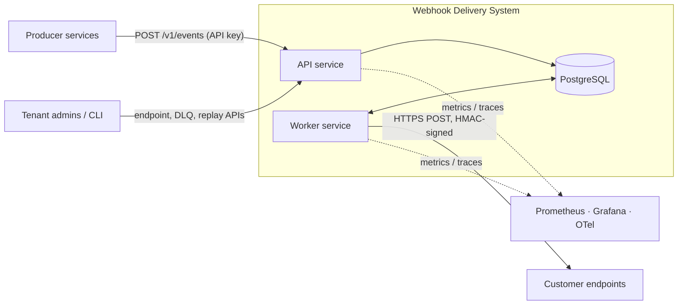
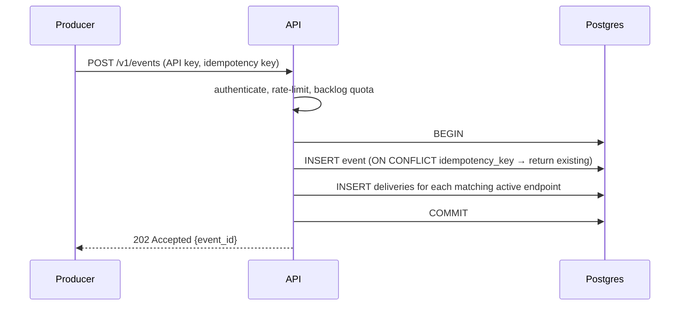
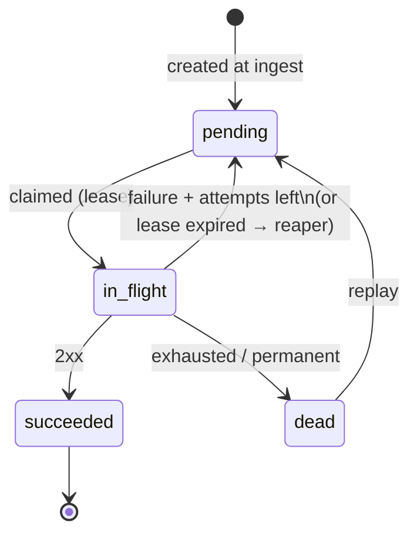
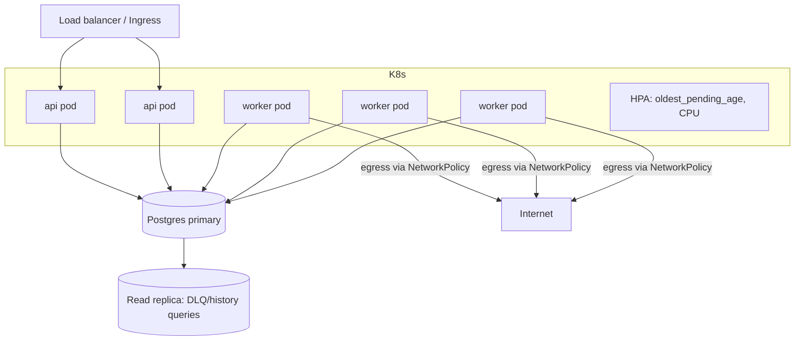

# Architecture

A multi-tenant, horizontally scalable webhook delivery service with at-least-once delivery, exponential-backoff retries, and a dead letter queue (DLQ). See `plan.md` (same folder) for the build plan and open trade-offs.

## 1. System Context



## 2. Components

| Component | Responsibility | State | Scales by |
|---|---|---|---|
| **API service** (`cmd/api`) | Auth, tenant quotas, endpoint/subscription CRUD, event ingest with fan-out, DLQ inspection and replay | Stateless | More replicas behind a load balancer |
| **Worker service** (`cmd/worker`) | Claim due deliveries, send HTTP, record attempts, schedule retries, move to DLQ, reclaim expired leases, run retention jobs | Stateless | More replicas (HPA on oldest-pending age) |
| **PostgreSQL** | Source of truth **and** the queue (`deliveries` table); attempt history; DLQ | Stateful | Vertical, then partitioning, read replicas, tenant sharding |
| **Observability stack** | Prometheus metrics, Grafana dashboards, OpenTelemetry traces, structured logs | External | Standard |

Internal packages (`internal/`): `store` (sqlc-generated queries, tenant scoping), `queue` (claim/complete/retry interface), `deliver` (HTTP sender, classification, backoff), `sign` (HMAC), `ssrf` (IP filtering dialer), `auth`, `ratelimit`, `config`, `telemetry`.

## 3. Key Design Decision: Postgres as the Queue

Deliveries are rows. The queue, the retry scheduler, and the DLQ are all views of one table.

- **Transactional enqueue**: event and delivery rows commit together, so there is no dual-write gap between "stored" and "queued".
- **Distributed claiming**: `FOR UPDATE SKIP LOCKED` lets any number of workers pull disjoint batches without coordination.
- **Delayed retry**: a retry is `UPDATE ... SET next_attempt_at = ...`; no separate delay queue.
- **DLQ**: `status = 'dead'`, queryable with SQL and replayable with one update; attempt history is preserved.
- **Escape hatch**: all queue operations go through a `Queue` interface, so the backend can be swapped (e.g. Kafka/SQS) if throughput outgrows Postgres.

Kafka was rejected for v1: per-message delayed retries need retry-topic tiers and suffer partition head-of-line blocking, and Postgres would still be required for history and DLQ queries.

## 4. Data Model

```mermaid
erDiagram
    TENANTS ||--o{ API_KEYS : has
    TENANTS ||--o{ ENDPOINTS : owns
    TENANTS ||--o{ EVENTS : produces
    EVENTS ||--o{ DELIVERIES : "fans out to"
    ENDPOINTS ||--o{ DELIVERIES : receives
    DELIVERIES ||--o{ ATTEMPTS : records

    TENANTS { uuid id PK; text status; int max_inflight; int events_per_sec; int max_pending }
    API_KEYS { uuid id PK; uuid tenant_id FK; text key_hash; text[] scopes; timestamptz revoked_at }
    ENDPOINTS { uuid id PK; uuid tenant_id FK; text url; text[] event_types; jsonb secrets; text status; int consecutive_failures; timestamptz circuit_open_until }
    EVENTS { uuid id PK; uuid tenant_id FK; text type; jsonb payload; text idempotency_key }
    DELIVERIES { uuid id PK; uuid event_id FK; uuid endpoint_id FK; text status; int attempt_count; timestamptz next_attempt_at; timestamptz lease_expires_at; text dead_reason }
    ATTEMPTS { uuid id PK; uuid delivery_id FK; int attempt_no; int status_code; int duration_ms; text error }
```

Hot-path indexes: partial `(next_attempt_at) WHERE status='pending'`, partial `(lease_expires_at) WHERE status='in_flight'`, `(endpoint_id, status)`, unique `(tenant_id, idempotency_key)`.

## 5. Data Flows

### 5.1 Ingest



Nothing is acknowledged before commit. If Postgres is down the API returns 503 and the producer retries safely using the idempotency key.

### 5.2 Delivery attempt

```mermaid
sequenceDiagram
    participant W as Worker
    participant D as Postgres
    participant E as Customer endpoint
    loop poll
        W->>D: claim batch (SKIP LOCKED, fair per tenant, per-endpoint cap) → in_flight + lease
        par for each delivery (bounded concurrency)
            W->>W: check circuit breaker, build signed request
            W->>E: POST (SSRF-safe dialer, 10s timeout, no redirects)
            E-->>W: status / error
            W->>D: INSERT attempt; UPDATE delivery
        end
    end
```

Outcome handling after each attempt:

| Result | Delivery update |
|---|---|
| 2xx | `succeeded`; reset endpoint failure counter |
| 410 | `dead` (`endpoint_gone`); pause endpoint |
| Other failure, attempts left | `pending`, `next_attempt_at = now + full-jitter backoff` (or `Retry-After`) |
| Other failure, exhausted | `dead` (`max_attempts`) → DLQ |

### 5.3 State machine



### 5.4 Failure recovery

- **Worker crash**: lease expires; reaper returns the row to `pending`. The request may already have reached the receiver, hence *at-least-once* (receivers dedupe on `webhook-id`).
- **Worker shutdown**: stop claiming, drain in-flight within a deadline, release remaining leases.
- **Postgres outage**: API returns 503; workers back off; no data loss.
- **Dead endpoint**: circuit breaker opens, deferring attempts; auto-disable after prolonged failure.

## 6. Isolation and Fairness

| Risk | Control |
|---|---|
| Tenant floods events | Per-tenant token bucket at ingest; `max_pending` quota (429) |
| Tenant dominates workers | Per-tenant `max_inflight`; claim takes at most K rows per tenant per batch |
| Slow endpoint hogs worker slots | Per-endpoint `max_concurrency`; circuit breaker with half-open probe |
| Cross-tenant data access | `tenant_id` on every table, scoped queries, Postgres row-level security |

## 7. Security Architecture

- **AuthN**: per-tenant API keys; only SHA-256 hashes stored; prefix shown for identification; revocable.
- **Payload integrity**: HMAC-SHA256 over `{id}.{timestamp}.{body}` (Standard Webhooks headers); multiple active secrets for zero-downtime rotation; timestamp enables replay rejection.
- **SSRF**: HTTPS only in production; custom dialer resolves DNS, rejects private/loopback/link-local/metadata ranges, and connects to the pinned IP (anti-DNS-rebinding); redirects not followed.
- **Secrets at rest**: endpoint signing secrets encrypted with envelope encryption (KMS in production).
- **Limits**: 256KB event size, 64KB response read, 10s request timeout.
- **Container/runtime**: non-root distroless images, read-only filesystem, NetworkPolicy restricting egress/ingress, `govulncheck` in CI.

## 8. Observability

- **Metrics** (Prometheus): `deliveries_total{status}`, `attempt_duration_seconds`, `queue_depth`, `oldest_pending_age_seconds` (primary SLO signal), `dlq_depth`, `inflight`, `circuit_open_endpoints`, `lease_reclaims_total`. Tenant label limited to top-N plus `other`.
- **Tracing** (OTel): ingest → delivery attempt linked via trace context stored on the delivery row.
- **Logging**: structured JSON with `tenant_id`, `event_id`, `delivery_id`, `endpoint_id`, `attempt`.
- **Alerts**: oldest pending > 5 min, DLQ growth rate, reaper reclaim spike, error-budget burn on delivery success rate.

## 9. Deployment Topology



Local development: Docker Compose with Postgres, api, worker, a configurable flaky mock receiver, Prometheus, and Grafana.

## 10. Scalability Path

1. **Single Postgres** (v1): low thousands of deliveries/sec; measured in the Phase 5 load test.
2. **Read offload**: DLQ/history/inspection queries to replicas.
3. **Partitioning**: time-partition `attempts` and finished `deliveries`; drop partitions instead of bulk deletes.
4. **Tenant sharding**: route tenants to separate Postgres clusters (shard map in a small control-plane table).
5. **Queue swap**: replace the Postgres `Queue` implementation with Kafka/SQS behind the same interface if sustained throughput exceeds what sharded Postgres handles economically.

## 11. Guarantees and Non-Guarantees

| Guarantee | Notes |
|---|---|
| No accepted event is lost | Durable commit before `202` |
| At-least-once delivery | Duplicates possible; receivers dedupe on `webhook-id` |
| Bounded retries, then DLQ | ~8 attempts over ~24h by default |
| Tenant isolation | Data and capacity |
| **Not guaranteed**: ordering | Retries reorder events; documented |
| **Not guaranteed**: exactly-once | Impossible over HTTP |
